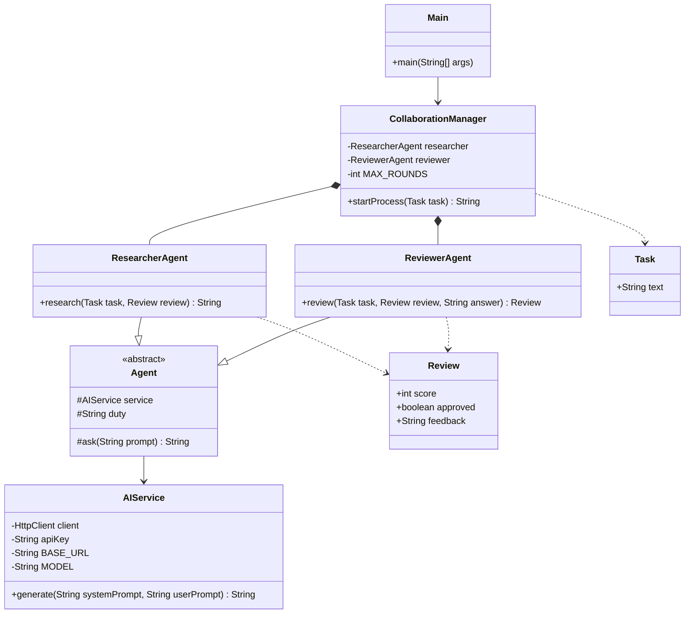

<div align="center">


# REXOR
### Two Minds. One Better Result.

</div>

REXOR is a tiny example of two AI agents working together. One writes an answer,
the other reviews it, and the writer tries again if the review is not good enough.

## How it works

1. **Researcher** writes an answer to your task.
2. **Reviewer** replies with three lines: a score, approval, and feedback.
3. If rejected, the Researcher improves the answer using that feedback.
4. Stops when approved, or after 3 rounds.

```text
Task -> Researcher -> Reviewer -> approved? -> Result
                          |
                          +-- no -> feedback -> Researcher again
```

## Files

| File | Job |
| --- | --- |
| `Main.java` | Reads your tasks and prints the result |
| `CollaborationManager.java` | Runs the research → review → refine loop |
| `Agent.java` | Shared code for both agents |
| `ResearcherAgent.java` | Writes and improves the answer |
| `ReviewerAgent.java` | Scores the answer and gives feedback |
| `Review.java`, `Task.java` | Simple data holders |
| `AIService.java` | The only class that talks to the AI |

## Architecture Overview



## Read the code in this order

1. `Main.java` — where the program starts
2. `CollaborationManager.java` — the whole idea of REXOR in one loop
3. `ResearcherAgent.java` and `ReviewerAgent.java` — the two agents
4. `AIService.java` — the one class that makes an HTTP request

No frameworks, no external libraries, no build tool, no environment variables.

## Setup

REXOR uses OpenRouter's free model, so no payment is needed.

1. Create a key at https://openrouter.ai/keys (starts with `sk-or-v1-`).
2. Paste it into `api-key.txt` in the project folder. This file is gitignored.
3. Put `rexor-0.1.0.jar` in that folder and run from there:

```bash
java -jar rexor-0.1.0.jar
```

The JAR reads `api-key.txt` from the folder you run it in.

No JAR? Build it from source:

```bash
javac -d out app/src/*.java
jar --create --file rexor-0.1.0.jar --main-class Main -C out .
java -jar rexor-0.1.0.jar
```

Or just click **Run** in IntelliJ. The free tier allows about 50 requests/day, roughly 8 tasks.

## Using another AI

Edit the two constants at the top of `AIService.java`:

```java
private static final String BASE_URL = "https://api.openai.com/v1";
private static final String MODEL = "gpt-4o-mini";
```

Then put an OpenAI key in `api-key.txt` instead.
