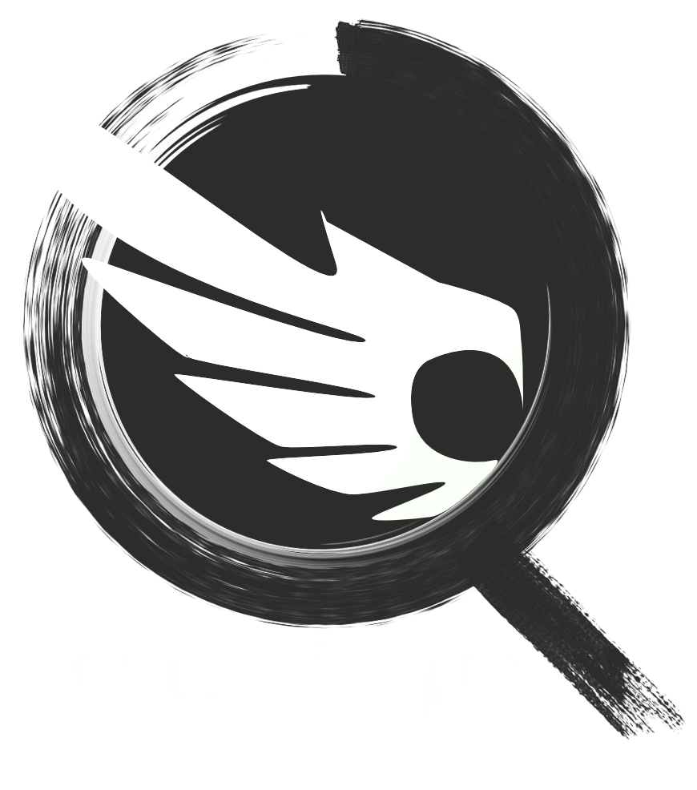
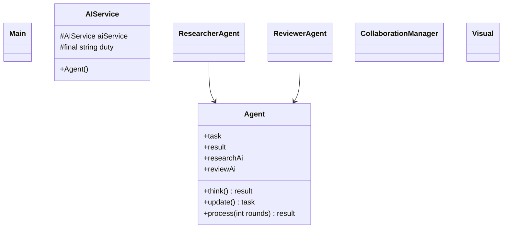

<div align="center">



# REXOR
### Two Minds. One Better Result.

</div>


## How It Works

1. **Researcher Agent** — Investigates the user's request and produces an initial result.
2. **Reviewer Agent** — Evaluates the research, identifies weaknesses, assigns a score, and decides whether to approve or reject it.
3. **Refinement** — If rejected, the Researcher improves its work based on the reviewer's feedback.
4. **Final Result** — The system delivers the approved content or handles the configured review-round limit.

## Review Process

- Users can configure the maximum number of review rounds.
- The Reviewer assigns a score and an approval/rejection decision to each submission.
- The Researcher uses feedback to improve rejected submissions.

## Core Concept

Rather than relying on a single AI agent, REXOR uses two complementary perspectives to improve the quality of generated content.

**Research → Review → Refine → Result**

## Project Structure

```text
REXOR/
├── README.md
├── .gitignore
└── app/
    └── src/
        └── Main.java
```

## Architecture Overview

This project models a multi-agent workflow (`ResearcherAgent` and `ReviewerAgent`) coordinated around a core `Agent` class, an `AI Service` layer, `Collaboration Manager`, a `visuel` (visual) module, and a `Main` entry point.

### System Diagram



### Components Summary

| Component | Role | Key Members / Notes |
| :--- | :--- | :--- |
| **`Main`** | Application entry point | Top-level execution flow |
| **`Agent`** | Core agent abstraction | Fields: `task`, `result`, `researchAi`, `reviewAi`; Methods: `think()`, `update()`, `process(int rounds)` |
| **`AIService`** | AI service / duty configuration | Protected `AIService` reference, protected final `duty` string, `+Agent()` constructor |
| **`ResearcherAgent`** | Research-focused agent | Connects to `Agent` |
| **`ReviewerAgent`** | Review-focused agent | Connects to `Agent` |
| **`CollaborationManager`** | Coordinates collaboration | Layout/dividers present in source diagram |
| **`Visual`** (`visuel`) | Visual / UI representation | Standalone card in source diagram |
## Tech Stack

- Java

## Project Status

Currently in development.
